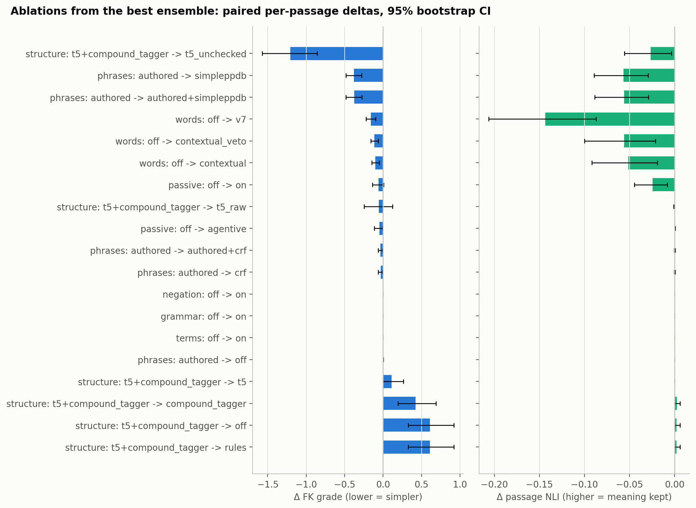
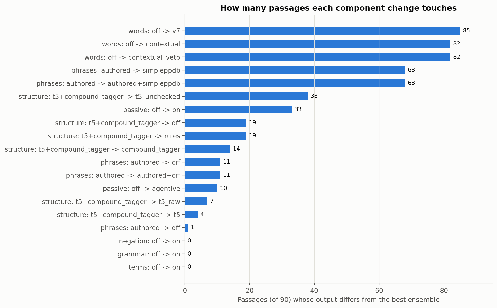
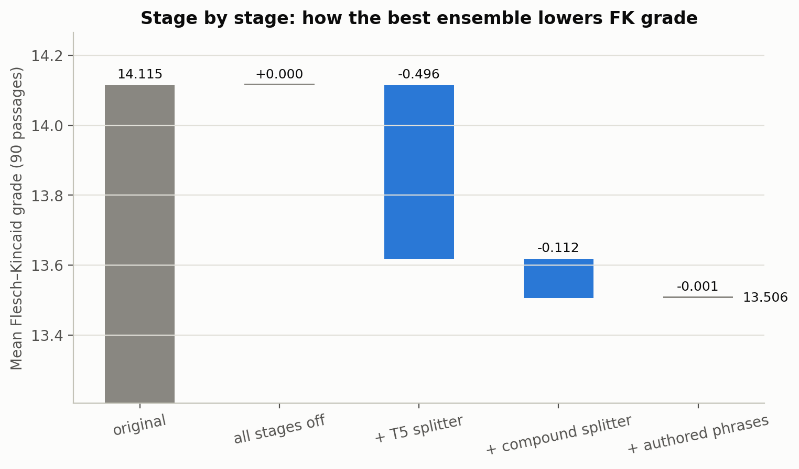
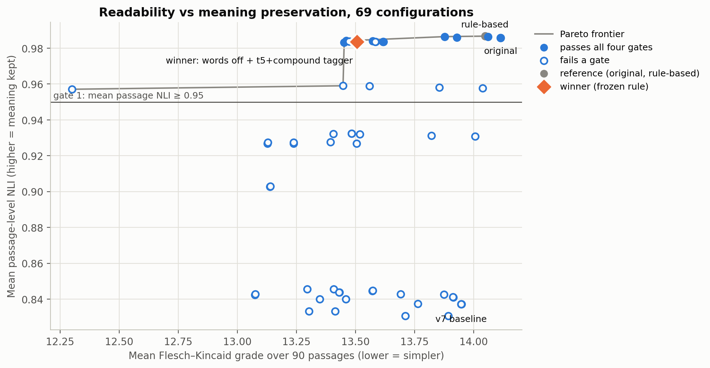
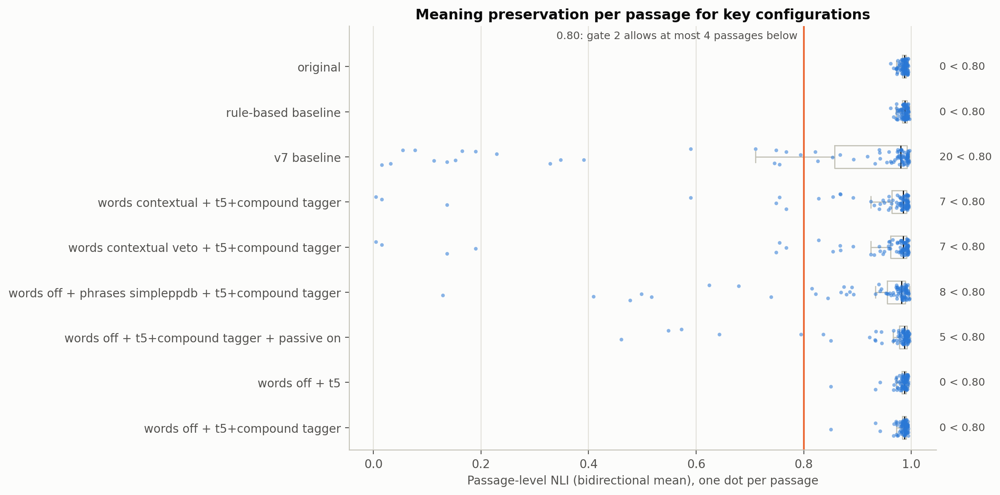
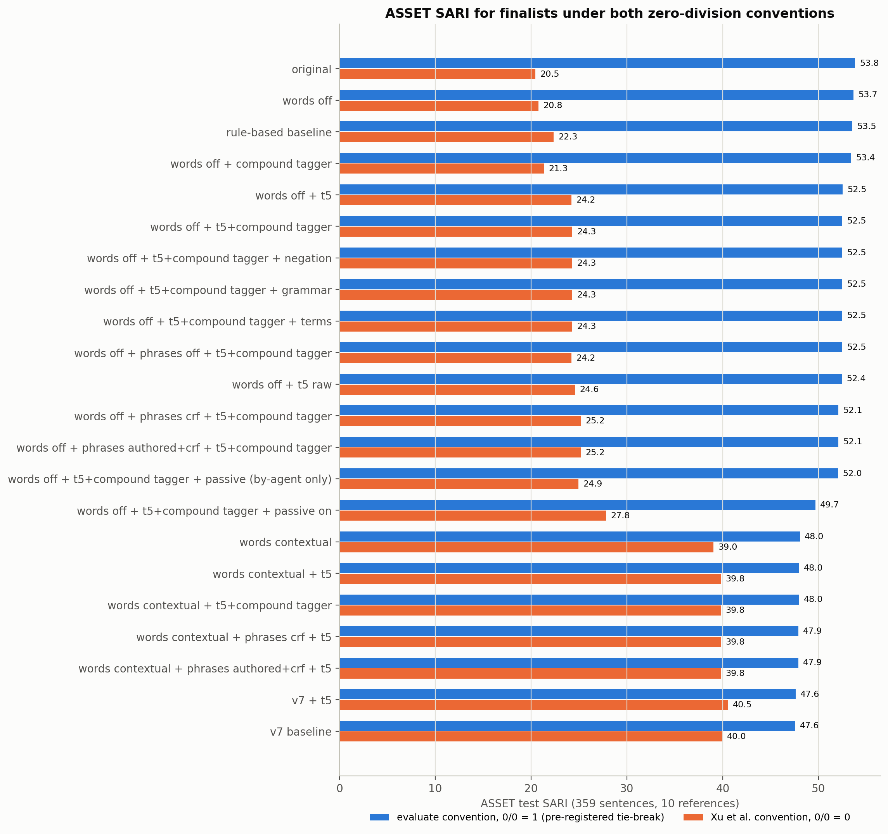

# Non-LLM ensemble v2: teammate stages, interactions and ablations, November 10, 2026

Does adding Chhoeng's passive-to-active converter and phrase finder (SimplePPDB
list, CRF detector with phrase replacer) change the best non-LLM ensemble, and
which components of that ensemble actually matter? This extends the
[November 9 study](../20261109-ensemble-study/README.md) on the same 90 sourced
development passages, with the [frozen selection rule](../20261109-ensemble-study/SELECTION_RULE.md)
unchanged and a design [pre-registered](DESIGN.md) before any new score was
read. 53 new configs plus the 16 November 9 cells make 69. No LLM is used
anywhere. Raw text stays local; this folder holds aggregates only.

## Result

**Winner under the frozen rule: `words=off, phrases=authored,
structure=t5+compound_tagger`.** That is the screened T5 splitter followed by
the PR #12 compound splitter on its output, plus the authored phrase rules.
There are no word substitutions, passive conversion or SimplePPDB phrases.
Opt-in file: [recommended-config.json](recommended-config.json). No default
changed.

| 90 passages | Original | v7 baseline | Nov 9 winner (words off + T5) | **v2 winner (+ compound)** |
|---|---:|---:|---:|---:|
| Flesch–Kincaid grade ↓ | 14.115 | 13.948 | 13.618 | **13.506** |
| Flesch reading ease ↑ | 38.32 | 39.49 | 39.49 | 39.77 |
| Words per sentence | 24.96 | 24.94 | 23.62 | 23.32 |
| Passage NLI mean | 0.9859 | 0.8373 | 0.9836 | 0.9837 |
| Passages with passage NLI < 0.80 | 0 | 20 | 0 | 0 |
| Sentence-level NLI mean | 0.9881 | 0.9129 | 0.9873 | 0.9873 |
| Changed passages | 0 | 85 | 16 | 20 |
| ASSET SARI, 0/0 = 1 (pre-registered tie-break) | 53.78 | 47.57 | 52.50 | 52.47 |
| ASSET SARI, Xu 0/0 = 0 | 20.45 | 39.95 | 24.23 | 24.29 |

On the 20 passages it changes, FK falls to 11.08 and passage NLI is 0.974
(lowest 0.851). It passes all four gates.

**Did passive or PPDB change the winner? No.** They change what sits in the
0.1-grade tie band, not the pick:

- **Passive, `on`** (his default `placeholder="auto"`, which adds "someone"/"people"): FK −0.06, but passage NLI −0.025
  and 5 passages under 0.80, so it **fails gate 2** in every words-off config.
  **Passive, `agentive`** (only passives with a "by" phrase): FK −0.045
  [−0.113, −0.007], NLI unchanged; it passes and ties with the winner, then
  loses the SARI tie-break (52.01 vs 52.47).
- **SimplePPDB list:** the biggest FK drop of any phrase level (−0.38) but
  passage NLI −0.057, 8 passages under 0.80, one negation lost and entities
  below `rule_based`. It **fails gates 1–4** wherever it is used. That matches
  Chhoeng's own note that the list "tested at 0% precision".
- **CRF finder (`crf`, his default sources):** FK −0.032 [−0.064, −0.005] on
  11 passages, NLI unchanged. It passes and ties, then loses the
  pre-registered tie-break (52.07 vs 52.47). **Under the Xu 0/0 = 0 convention it wins**
  (25.19 vs 24.29); see the disclosure below.
- **T5 + compound stacking** is the one new level that moved the pick: −0.112
  grade over T5 alone on 4 passages, with NLI unchanged.

## Ablations: do only the word models matter?

**No.** In the best ensemble no word model is used at all. Every word model
added to it lowers FK a little and costs real meaning. Almost all of the gain
comes from the structure stage.

Paired per-passage deltas against the winner (90 passages, percentile
bootstrap 95% CI, 10,000 resamples, seed 20261110). A component "matters"
(pre-registered) if |ΔFK| ≥ 0.02 or |ΔNLI| ≥ 0.005 with a CI excluding zero.
Gates use the frozen rule.

| Remove / replace (from the winner) | ΔFK [95% CI] | Δ passage NLI [95% CI] | Passages changed | Gates |
|---|---:|---:|---:|---|
| structure → off (or old rules) | **+0.608** [+0.326, +0.920] | +0.002 [−0.000, +0.006] | 19 | pass |
| structure → compound only | **+0.424** [+0.195, +0.688] | +0.002 [−0.000, +0.006] | 14 | pass |
| structure → T5 only | +0.112 [−0.001, +0.266] | −0.0001 [−0.0002, −0.0000] | 4 | pass |
| structure → T5 without generation checks (`t5_raw`) | −0.053 [−0.246, +0.125] | −0.0005 [−0.0011, −0.0001] | 7 | pass |
| structure → T5 without any checks (`t5_unchecked`) | **−1.206** [−1.572, −0.858] | **−0.027** [−0.056, −0.003] | 38 | fail (numbers, entities) |
| phrases → off | +0.001 [+0.000, +0.002] | +0.0000 | 1 | pass |
| phrases → `crf` (Chhoeng's default) | **−0.032** [−0.064, −0.005] | +0.0001 [−0.0004, +0.0005] | 11 | pass |
| phrases → `authored+crf` | −0.033 [−0.066, −0.005] | +0.0001 | 11 | fail (entities) |
| phrases → SimplePPDB (alone or + authored) | **−0.378** [−0.483, −0.279] | **−0.057** [−0.089, −0.029] | 68 | fail 1–4 |
| passive → on | −0.058 [−0.138, +0.005] | **−0.025** [−0.045, −0.008] | 33 | fail (gate 2) |
| passive → agentive | **−0.045** [−0.113, −0.007] | +0.0005 [+0.0002, +0.0008] | 10 | pass |
| words → v7 | **−0.158** [−0.221, −0.097] | **−0.144** [−0.206, −0.087] | 85 | fail 1, 2, 4 |
| words → contextual (PR #8) | **−0.099** [−0.147, −0.052] | **−0.052** [−0.092, −0.019] | 82 | fail 1, 2, 4 |
| words → contextual + entailment veto | **−0.112** [−0.159, −0.066] | **−0.056** [−0.100, −0.021] | 82 | fail 1, 2, 4 |
| negation / grammar / terms on | 0 | 0 | 0 | pass (identical output) |

What the table says:

- **Structure carries the ensemble.** Removing it gives back 0.61 grade.
  T5 alone accounts for −0.496 of the winner's −0.609 from the original;
  the compound splitter adds −0.112 (CI touches zero at −0.001, on 4
  passages); the authored phrases add −0.001 (1 passage).
- **T5's checks earn their place.** Dropping only the per-sentence generation
  checks is neutral on FK (CI spans zero) and slightly lowers NLI. Dropping
  every check gives −1.2 grade but loses a number and pushes 4 passages under
  0.80. The 192-token length cut-off never binds on this panel (longest
  sentence 134 tokens; ASSET 79), so ablating it would change nothing.
- **Word models help FK only a little and always hurt meaning.** v7 and
  contextual words lower FK by 0.10–0.16 but cut passage NLI by 0.05–0.14,
  touch 82–85 passages and fail gates 1, 2 and 4.
- **The entailment veto did not fix contextual words.** It was pre-registered
  at Chhoeng's tuned 0.575 with his small NLI model, so no threshold was tuned
  on this panel. NLI went from 0.9322 to 0.9276 and 7 passages are still under
  0.80. Vetoing one edit lets the next-ranked word take the slot, and those
  replacements are no safer by the evaluation model.
- Negation, grammar and term protection never change an output here (as on
  November 9). Ablating them needs a panel where they fire.

Stage by stage for the winner:

## All configs

Full table: [results-table.md](results-table.md). Every metric, changed-only
means, stage counts, gates, selections, activity tests from both bases,
per-passage FK/NLI by passage ID and the paired deltas:
[aggregate-results.json](aggregate-results.json).

## Selection details and disclosure

- **Frozen rule:** 21 configs pass all gates. The lowest FK is `t5_raw`
  (13.453). Eight passing configs fall inside its 0.1-grade tie band:
  `t5_raw`, T5+compound with authored phrases (13.506), with phrases off
  (13.507), with `crf` (13.474) and with agentive passive (13.461), plus
  T5+compound with negation, grammar or terms on. Those last three are
  output-identical to the winner on both panels. The pre-registered
  tie-break, ASSET SARI with `evaluate`'s 0/0 = 1, gives T5+compound +
  authored phrases 52.468, ahead of phrases off at 52.466, `t5_raw` at 52.413,
  `crf` at 52.07 and agentive passive at 52.01. Among the configs with
  identical output, the plain one (the others' extra stages never fire) is
  reported.
- **Disclosure, SARI convention:** under 0/0 = 1 the untouched source scores
  53.8 and outranks every system, so the tie-break favors configs that change
  less. Under the Xu 0/0 = 0 convention the same tie goes to
  **`words=off, phrases=crf, structure=t5+compound_tagger`** (25.19; FK 13.474,
  NLI 0.9837). Both picks pass every gate, and they differ by 0.03 grade on
  11 passages. The November 9 report switched to 0/0 = 0 after scoring; v2
  uses the convention pre-registered in `31f2334`, as `DESIGN.md` states.
- **Labeled alternatives (post hoc):** alt 1, gate 4 on non-sentence-initial
  entities, and alt 2, gates 1–2 on sentence-level NLI plus alt 1. Both pick
  the same winner under 0/0 = 1. Under 0/0 = 0, alt 2 picks contextual words +
  authored+CRF phrases + T5 (SARI 39.8). Sentence-level means are diluted by unchanged
  sentences, as the November 9 diagnosis showed.

ASSET test was already used on November 9 (not fresh). ASSET finalists here
are every config tied with the winner, plus the configs tied in the
alternative rankings.

## What was run (phases)

| Phase | Design (committed before running, except where noted) | Configs |
|---|---|---:|
| C: OFAT for the 7 new levels from the Nov 9 winner and from v7 | [design-ofat.json](design-ofat.json) (pre-registration commit `30f9de2`) | 14 new |
| W ablations (run alongside C) | [design-ablation-W.json](design-ablation-W.json) | 9 new |
| C2: interactions (passive × structure × words, phrases × words, T5+compound × words); all 7 levels were active | [design-interactions.json](design-interactions.json), derived by [derive_designs.py](derive_designs.py) (`56625f7`) | 21 new |
| D: ablations from the best after C/C2 | [design-ablation-t5compound.json](design-ablation-t5compound.json) (`26fcd7e`) | 12 new |
| ASSET tie-break and finalists | design-asset-*.json | 13 configs × 359 sentences |

Two ASSET designs were committed after their jobs ran: `design-asset-tie.json`
(committed 16:38, after job `3aa861e9e18a` ran 16:17–16:21) and
`design-asset-alternatives.json` (committed 19:02, after job `27ea172afedf`).
Their configs follow mechanically from the pre-registered tie rule, and the
alternatives set is labeled post hoc, so the winner is unaffected.

Post-study fix: when term protection blocked the structure stage, the pipeline
reset to the input text, silently dropping earlier negation/passive edits. It
now reverts only the structure stage. This needs terms on together with
negation or passive, which no reported config hit, so no result changes.

## Chhoeng's stages in the pipeline

The passive converter (`passive/`, PR #14) and the phrase finder, CRF detector
and phrase replacer (`pos_tag/`, PRs #14/#15) are **Chhoeng's work**. They run
unchanged, with no fixes needed, through opt-in adapters in
`models/src/cleartext/teammate_stages.py` (see
[models/docs/TEAMMATE_STAGES.md](../../../models/docs/TEAMMATE_STAGES.md)).
`EnsembleClearText.analyze()` gained `passive_converter=`, `phrase_finder=`,
`word_veto=` and stacked `structure_rewriter=[...]`; with defaults, outputs are
unchanged. `PhraseFinderStage` applies his suggestions in base form (no
inflection, like his `apply_replacements`). Some SimplePPDB losses are
grammar breaks from that, not only wrong paraphrases.

## Reproduction and provenance

[provenance.json](provenance.json) records the commits, the plan hash, the
signatures, the reuse check, artifact/source/panel hashes, runtime and every
queue receipt. Yoga CPU, one thread per process, `PYTHONHASHSEED=0`, offline
models: 18 bounded batches (≤ 25 min each, 5.2 h of batch time in total) on the
personal queue at `later` priority, checkpointed per cell.

- **New source tree, old cells reproduced:** every November 9 cell that v2
  regenerated matches the November 9 output on **90/90** passages: v7
  baseline, words off + T5, original, rule_based, and five more configs.
  ASSET original and rule_based match 359/359. `report` refuses to merge
  any conflicting cell.
- **Cache reuse:** the v2 plan reads the November 9 T5, grammar and
  lexical-decision memos and metrics only after `reuse_compatibility`
  verified identical artifacts, runtime and sources. The only changed source
  is `EnsembleClearText.analyze`, compared by AST with that method removed.
  The scoring signature is identical.
- **Rerun:** `python -m evals.ensemble_study report --state <nov9>/run1 --state
  <v2>/run1 --design ... --best <winner>` then `python make_figures.py
  aggregate-results.json design-ablation.json` (matplotlib in a separate
  venv). Local state: `$HOME/.local/state/cleartext/ensemble-v2-20261110`.

These are inspected development passages. Readability, NLI, entity and SARI
scores are automatic signals, not percentages of correct simplifications.
