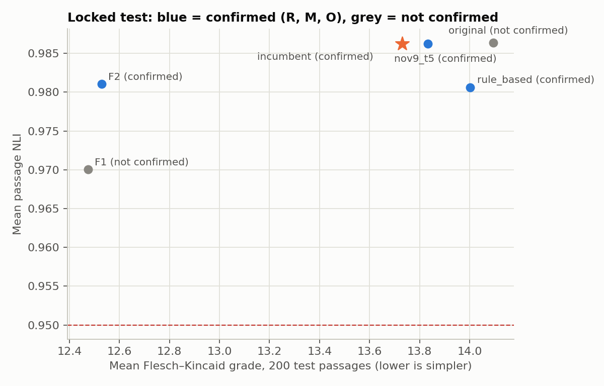
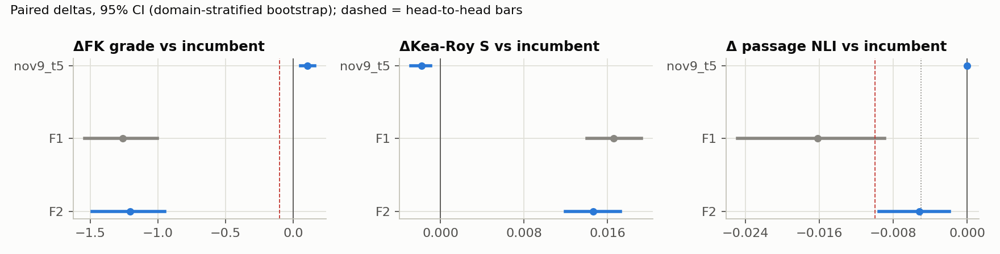
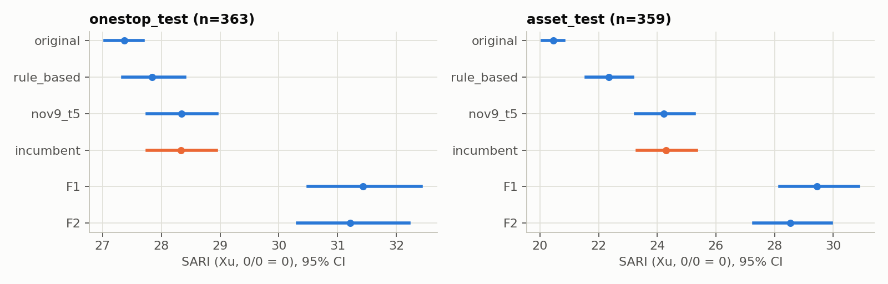

# Locked-test run of the parameter-sweep finalists, November 17, 2026

This is the one-shot run on test set v3's **locked test split**: 200
passages, 168 standard and 32 Simple English controls. Joshua approved it on
2026-11-16. It runs the finalists chosen on dev by the
[parameter sweeps](../20261116-param-sweeps/README.md). The finalists and
the judging rule ([FINALISTS.md](FINALISTS.md), [finalists.json](finalists.json))
were committed in `bffd074` (FINALISTS.md clarified in `3e5fa57`), and the judging code in `3e5fa57`, both before
the split was unlocked. Nothing was changed or rerun after scores were read.
No LLM is used anywhere. Raw text stays local; this folder holds aggregates
only.

## Result

- **F2 beats the incumbent under the pre-registered head-to-head rule.** F2
  is the "safe split": T5 with every soft structural check waived, the five
  hard checks kept, and a small-NLI floor of 0.5 per split.
  - Its own verdict is *confirmed* (R, M and O all pass).
  - Against the incumbent: **ΔFK −1.20** [−1.48, −0.95], **ΔS +0.015**
    [+0.012, +0.017], **Δ passage NLI −0.0052** [−0.0096, −0.0019].
  - Caveats: F2 was a **post hoc** finalist (sweep amendment 3), and it does
    not meet the test set v3 protocol's stricter "no worse in meaning than the
    incumbent" bound (NLI CI lower end ≥ −0.005; it reaches −0.0096).
- **F1 is not confirmed.** F1 is the dev rule's finalist: the safe split
  without an NLI floor, plus SimplePPDB phrases with ppdb ≥ 4.3. It fails M
  on test: it loses a negation (gate 3) and two entities (gate 4), and 7
  passages fall below 0.80 NLI. That is the dev warning (NLI −0.029)
  carried through.
- **The incumbent is confirmed on test** (FK 13.73; −0.34 vs the source on the 168 standard passages),
  and so is the November 9 winner. `original` fails R by construction.

| System | Verdict | FK (200) | Kea S | Passage NLI | NLI < 0.8 | Entities | Num/neg fails | ΔFK vs `original`, standard [95% CI] | ΔS vs `original`, standard [95% CI] | Controls changed-token rate |
|---|---|---:|---:|---:|---:|---:|---:|---:|---:|---:|
| `original` | not confirmed (R) | 14.096 | 0.2502 | 0.9864 | 0 | 1.0000 | 0/0 | 0 | 0 | 0.000 |
| `rule_based` | confirmed | 14.003 | 0.2523 | 0.9806 | 2 | 1.0000 | 0/0 | −0.107 [−0.138, −0.078] | +0.0024 [+0.0015, +0.0034] | 0.001 |
| `nov9_t5` | confirmed | 13.833 | 0.2539 | 0.9862 | 0 | 1.0000 | 0/0 | −0.251 [−0.394, −0.129] | +0.0033 [+0.0017, +0.0051] | 0.003 |
| **incumbent** | **confirmed** | 13.731 | 0.2557 | 0.9862 | 0 | 1.0000 | 0/0 | −0.339 [−0.490, −0.208] | +0.0049 [+0.0031, +0.0069] | 0.007 |
| F1 | **not confirmed (M: gates 3, 4)** | 12.474 | 0.2723 | 0.9701 | 7 | 0.9985 | 0/1 | −1.674 [−2.006, −1.376] | +0.0218 [+0.0187, +0.0250] | 0.027 |
| **F2** | **confirmed** | **12.528** | 0.2703 | 0.9810 | 2 | 1.0000 | 0/0 | −1.611 [−1.938, −1.313] | +0.0196 [+0.0165, +0.0228] | 0.024 |

Head-to-head with the incumbent (all 200 passages, paired, domain-stratified bootstrap):

| Finalist | ΔFK [95% CI] | ΔS [95% CI] | Δ passage NLI [95% CI] | Beats incumbent (FINALISTS.md rule) | v3 "no worse in meaning" |
|---|---:|---:|---:|---|---|
| F1 | −1.258 [−1.541, −1.005] | +0.0166 [+0.0140, +0.0192] | −0.0162 [−0.0249, −0.0089] | no (verdict not confirmed; ΔNLI < −0.010) | no |
| **F2** | **−1.203 [−1.484, −0.950]** | +0.0146 [+0.0120, +0.0173] | −0.0052 [−0.0096, −0.0019] | **yes** | no (CI lower end −0.0096) |
| `nov9_t5` | +0.102 [+0.053, +0.159] | −0.0018 [−0.0028, −0.0010] | −0.0000 [−0.0001, +0.0000] | no (ΔFK > 0: less simple) | yes |

SARI, reported without a gate. Xu 0/0 = 0 is primary (sentence-bootstrap
95% CI); `evaluate`'s 0/0 = 1 is reported alongside, as pre-registered.

| System | OneStop test, Xu | OneStop test, `evaluate` | ASSET, Xu | ASSET, `evaluate` | Output FK, OneStop / ASSET |
|---|---:|---:|---:|---:|---:|
| `original` | 27.37 [27.04, 27.69] | 62.24 | 20.45 [20.08, 20.81] | 53.78 | 11.53 / 11.92 |
| `rule_based` | 27.85 [27.34, 28.40] | 62.14 | 22.34 [21.57, 23.16] | 53.54 | 11.51 / 11.83 |
| `nov9_t5` | 28.34 [27.76, 28.95] | 58.80 | 24.23 [23.26, 25.26] | 52.50 | 10.84 / 11.24 |
| incumbent | 28.33 [27.76, 28.94] | 58.80 | 24.29 [23.31, 25.33] | 52.47 | 10.83 / 11.22 |
| F1 | 31.43 [30.50, 32.43] | 51.70 | 29.44 [28.18, 30.88] | 51.14 | 9.33 / 10.47 |
| F2 | 31.21 [30.32, 32.21] | 52.59 | 28.54 [27.28, 29.94] | 51.57 | 9.37 / 10.53 |

**The SARI ranking reverses under the `evaluate` convention.** With 0/0 = 1,
an n-gram class that a system neither adds nor deletes scores as perfect.
That rewards copying, so the unchanged source scores highest (62.24 on
OneStop) and every system that edits more scores lower. F2 is below the
incumbent on both sets there. Xu's 0/0 = 0 is primary because it does not
reward copying (the November 9 and 10 reports discuss the same issue). Read
SARI as convention-dependent, not as independent support.

## What this means

- **Strongest candidate: F2.** It is the only finalist that is confirmed on
  the locked test and clears the pre-registered head-to-head. It is about 1.2
  grades simpler than the incumbent on unseen passages, with the smaller NLI
  cost of the two simpler finalists. Under Xu SARI it is 3–4 points higher on
  both reference sets; under `evaluate` SARI it is 1–6 points lower (see
  above).
- **How F2 was selected.** It was chosen post hoc on dev, after the
  pre-registered dev rule had said "no change". The test result is its first
  untouched evidence. It holds on test, but the v3 protocol's strict
  meaning bound is not met.
- **Adoption.** Whether to adopt F2 as the new opt-in default is Joshua's
  call. Nothing here changes a default.
- **F1's meaning losses.** F1 adds SimplePPDB phrases and has no NLI floor.
  On test it loses a negation and two entities; F2 loses none. This run
  cannot say which of the two differences causes the losses.
- **Where F2 loses meaning:** two passages under 0.80 NLI (one political
  science, one legal), the same two that F1 also drops.

## Provenance

- **Plan:** `~/.local/state/cleartext/param-sweeps-20261116/test/plan.json`,
  frozen at `3e5fa57` with `param_sweeps freeze --unlock-test finalists.json
  --dev-plan <dev plan>`. That check passed: the finalists were committed in
  `bffd074` and unmodified, and the generation and scoring sources,
  artifacts and signatures are identical to the dev plan's.
- **Panel hashes:** test `92b2fe27…`, OneStop test `af62f9e6…`, ASSET `87bd29c0…`.
- **Queue:** Yoga, personal queue at `later` priority, one job at a time,
  1 torch thread.
  - Generation and scoring: 7 batches, 1.9 h. Jobs `1c5382c01113`,
    `65adce413995`, `7c2054de1ebe`, `7f63534ce3d4`, `80626508adda`,
    `85d9cfe4d9c7` and `d8e1e2a888c6`.
  - Judgement: `param_sweeps final`, job `288681809a10`.
  - Every system ran once. No cell was rerun after scores were read.
  - The first attempt of the OneStop generation job (`d8e1e2a888c6`) was
    stopped by the queue's memory check after 671 s, with about 2,144 outputs
    saved and no receipt. The queue resumed it and completed the 34 missing
    cells. This was generation only, with no scoring, before any score was
    read.
- **Signatures:** generation `223acb6f0e3f…` and scoring `b818b07ac341…`,
  both identical to the dev plan's.
- **Rerun the judgement:** `python -m evals.param_sweeps final --state <test
  state> --finalists finalists.json --out <dir>`, then `python
  make_figures.py aggregate-test.json` (matplotlib in a separate venv).
- **Limits:** these are automatic signals (readability formulas, NLI,
  heuristic entity and negation checks, SARI), not percentages of correct
  simplifications. ASSET test was used before. **The test split has now
  been used once and is no longer untouched.**
