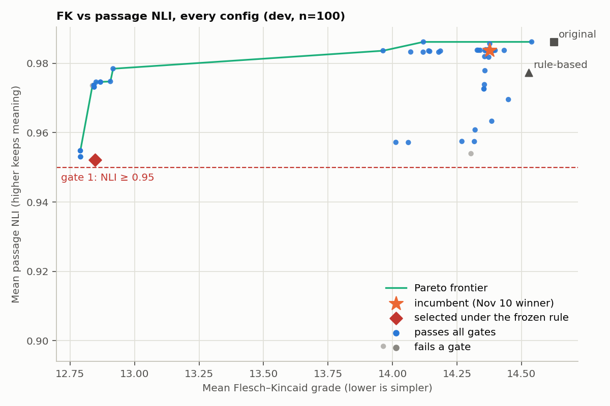
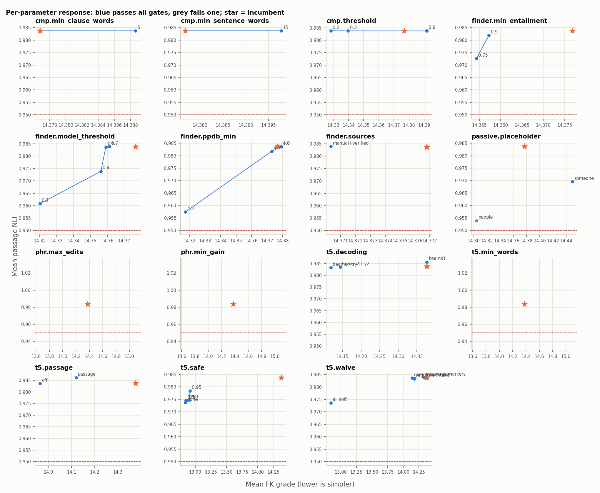
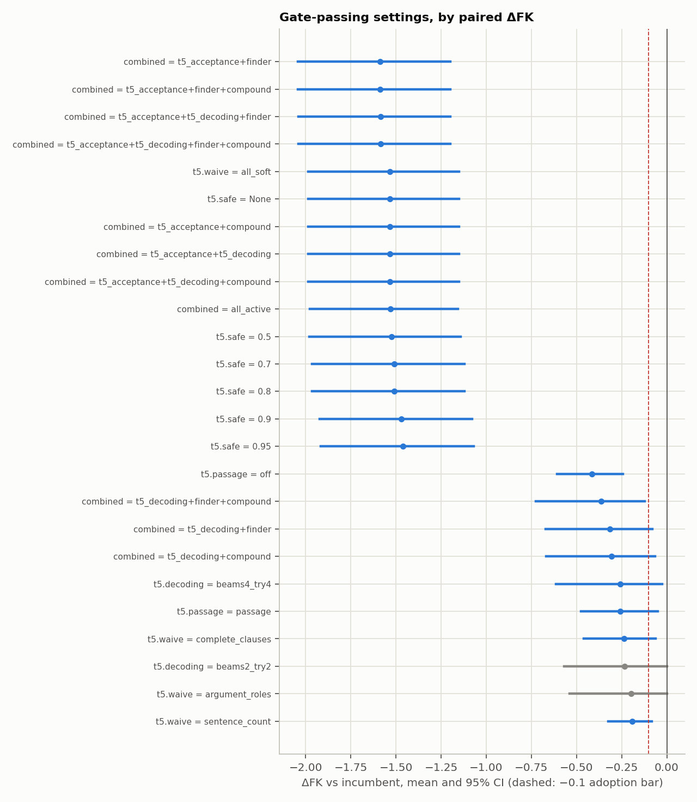

# Parameter sweeps of the non-LLM ensemble, November 16–17, 2026

Do tuned stage settings beat the November 10 winner (the **incumbent**:
`words=off, phrases=authored, structure=t5+compound_tagger`)? This study
swept settings, not just on/off levels, on the new test set v3 **dev** split
(100 passages, of which 16 are Simple English controls). It used the
pre-registered [protocol](SWEEP_PROTOCOL.md) (three dated amendments) and the
[parameter inventory](PARAMETERS.md). No LLM is used anywhere. Raw text stays
local; this folder holds aggregates only.

## Answer

**Recommendation under the pre-registered rule: no change.** The incumbent
stays.

- **Safe split.** One family of settings is far simpler on dev and passes
  every gate. It loosens the T5 splitter's structural checks while keeping
  its five hard checks (numbers, negation, entities, code literals,
  technical phrases): FK drops by **1.5 grades** (14.38 → 12.84, 95% CI
  [−1.99, −1.15]) and Kea-Roy's S rises by 0.017. The cost is passage NLI
  −0.010 (0.9838 → 0.9737).
- **Why the rule still says no change.**
  - 13 gate-passing configs lie within 0.1 grade of the lowest FK.
  - The pre-registered tie-break (higher S) picks the one with the most
    phrase edits.
  - That pick fails the adoption test on meaning: ΔNLI −0.032, against a
    limit of −0.010.
- **Settings that pass the full adoption test** (the safe split with a
  small-NLI floor of 0.5–0.8) were in the tie band but lost the S tie-break.
  See [disclosure](#selection-and-disclosure).

Finalists for the one-shot locked test
([../20261116-locked-test/FINALISTS.md](../20261116-locked-test/FINALISTS.md),
committed before unlocking):

| Finalist | What it is | Dev FK | ΔFK vs incumbent [95% CI] | Dev Kea S | Dev passage NLI | ΔNLI [95% CI] | NLI < 0.8 | ASSET SARI (Xu) | OneStop dev SARI (Xu) |
|---|---|---:|---:|---:|---:|---:|---:|---:|---:|
| incumbent | Nov 10 winner | 14.377 | — | 0.2527 | 0.9838 | — | 1 | 24.29 | 28.86 |
| **F1** (rule) | safe split (every soft T5 check waived) + SimplePPDB phrases with ppdb ≥ 4.3 | 12.790 | −1.587 [−2.043, −1.200] | 0.2715 | 0.9548 | −0.029 [−0.054, −0.010] | 4 | 29.44 | 31.69 |
| **F2** (post hoc, amendment 3) | safe split: soft checks waived per sentence and per passage, hard checks kept, small-NLI floor 0.5 per split | 12.851 | −1.526 [−1.980, −1.141] | 0.2700 | 0.9746 | −0.009 [−0.019, −0.002] | 2 | 28.54 | 31.19 |
| `nov9_t5` | Nov 9 winner (T5 only) | 14.433 | +0.056 [+0.016, +0.107] | 0.2519 | 0.9837 | −0.000 | 1 | 24.23 | 28.85 |
| `original` | source | 14.627 | +0.250 | 0.2502 | 0.9861 | +0.002 | 0 | 20.45 | 27.70 |

All of these pass gates 1–4 and the over-edit gate on dev (control
changed-token rate F1 0.015, F2 0.011). CIs come from the domain-stratified
paired bootstrap.

## Per-component goals (pre-registered)

| Component | Goal | Answer on dev |
|---|---|---|
| **T5 split acceptance** | Recover part of `t5_unchecked`'s FK gain and still pass every gate | **Yes.** `t5_unchecked` is −1.54 here but loses a number (gate 3). Waiving only the soft checks keeps all five hard checks and gives −1.53 while passing every gate. A small-NLI floor buys NLI back: at 0.5, −1.53 (ΔNLI −0.009); at 0.95, −1.46 (ΔNLI −0.005, 1 passage < 0.8). Single waivers are small: `complete_clauses` −0.24, `sentence_count` −0.19; 10 of the 14 change nothing. The passage-aware check alone is −0.26; dropping the passage check is −0.41. |
| T5 decoding | Do lower beams add passing splits? | Somewhat: trying 4 of 4 beams −0.26, 2 of 2 −0.23 (CI touches 0). Greedy or 4-beam top-1 changes nothing. |
| T5 minimum length | Is skipping short sentences worth it? | No effect: 8–20 words changes no output (T5 rarely splits short sentences). |
| Compound tagger | Does a lower threshold add splits? | Barely: 0.2 −0.05, 0.3 −0.04 (CIs touch 0). Higher thresholds and minimum lengths cost +0.01–0.02. |
| Authored phrases | More edits / lower gain? | No output changes at all (no passage has a second authored match). |
| Phrase finder | Beat `crf`'s −0.02 safely | CRF threshold 0.2 −0.06, but NLI −0.023 and it fails the over-edit gate. SimplePPDB ≥ 4.3 −0.06 (NLI −0.026, 5 passages < 0.8, passes). ≥ 4.5 is a near no-op. A replacer NLI floor of 0.9 makes `crf` safe (NLI −0.002) at −0.02. |
| Passive | Does a fixed placeholder pass gate 2? | `someone` passes but raises FK (+0.07). `people` fails gate 2 and the over-edit gate. `agentive` −0.02 passes. |
| **Word swaps** | Find any word setting that passes the gates and lowers FK | **Not shown.** On the screen (a third of dev), 26 of 30 word settings fail gates 1–3. Every default model, meaning floor, detector/noun threshold, gain or frequency margin, alpha, 2 edits per passage and refilling veto fails. Survivors: v7 threshold 0.7 (−0.14 FK on the screen), 0.8 (−0.06), 0.9 (a no-op) and veto 0.97 without refill (−0.11). They did not finish on the full panel within the budget cap (amendment 2), so they are **incomplete**, not adopted. Even the best gains about 0.1 grade, a tenth of the safe split's. |

Per-parameter responses (blue passes every gate; the star is the incumbent):

Full table, every config with gates and CIs: [results-dev.md](results-dev.md).
Machine-readable: [aggregate-dev.json](aggregate-dev.json), which includes
per-passage FK, S, NLI and entities by passage ID, per-domain summaries, SARI
and the alternative gate-4 ranking. Word screen: [screen-words.json](screen-words.json).

## Selection and disclosure

- **Tie-break behavior.** S rewards lexical edits, so among near-equal FK
  it picks the config that makes the most phrase edits. That config also
  loses the most meaning. With FK as primary, 0.1-grade ties and S as the
  tie-break, the rule therefore favored a config that the adoption test then
  rejected. This is a property of the pre-registered rule and is reported
  as found.
- **F2.** Amendment 3 added F2 after the dev scores were read, labeled post
  hoc, so that the locked test also checks the adoptable setting. It does
  not change the dev recommendation.
- **The safe split's "passage-aware check" does almost nothing.** A waiver
  applies at passage level too (`passage_waive` unset), so with every soft
  check waived the passage-aware mode adds only its code-literal check.
  `t5.safe = none` and `t5.waive = all_soft` give identical outputs on dev.
  The hard checks are what keep these settings safe.
- **F1's exact tie.** F1 has an exact dev tie with the same config plus
  `cmp.threshold = 0.2`. The simpler config was taken.
- **Gate 4** uses the fixed entity check (amendment 1). On dev, `rule_based`
  scores 1.0, so gate 4 means "never lose an entity". The ranking with the
  old capitalized check is in `alternative_capitalized_entities` and picks
  the same config.
- **Amendments.** All three are dated in the protocol, with what had been
  read at each one. The word-arm cap (amendment 2) was set before any
  full-panel word score was read.
- **Panel limits.** These are dev passages, and their numbers chose the
  finalists. Readability, NLI, entity and SARI scores are automatic signals,
  not percentages of correct simplifications. ASSET test was used before and
  is not fresh.

## What was run

| Step | Design | Configs | Panel |
|---|---|---:|---|
| Smoke (harness check, selects nothing) | [design-smoke.json](design-smoke.json) | 30 | old 90 passages |
| Phase 0 + A, structure and phrases | [run-1-cheap.json](run-1-cheap.json) (= phase 0 without word levels + [A-structure](design-A-structure.json) + [A-phrases](design-A-phrases.json)) | 67 | dev, 100 |
| Phase A, words, screen | [run-2-words.json](run-2-words.json) (= phase 0 word levels + [A-words](design-A-words.json)) | 30 | dev shard 0/3 (34) |
| Word survivors | [run-3-words-survivors.json](run-3-words-survivors.json) | 4 | dev, 100 (incomplete, amendment 2) |
| Phase B | [design-B-combined.json](design-B-combined.json), derived by [derive_designs.py](derive_designs.py) | 17 | dev, 100 |
| Finalist SARI | [../20261116-locked-test/finalists.json](../20261116-locked-test/finalists.json) | 6 | ASSET test (359), OneStop dev (181) |

**Reproduction checks.** On the old panel, the harness reproduces the
November 9/10 outputs on **90/90** passages for all 11 replayed configs,
including `words=v7`, the T5 references and the teammate stages. That covers
the new default-preserving arguments and the threshold-free word-decision
cache. The incumbent's ASSET SARI (24.29) also matches the November 10 report.

## Code (opt-in; no default changed)

- [`evals/param_sweeps.py`](../../param_sweeps.py): the sweep harness (IDs,
  frozen plans, checkpointed batches, report). It builds on
  `ensemble_study`'s storage and scoring and `testset_v3`'s metrics, gates and
  bootstrap. It refuses locked test rows unless a committed finalists design
  unlocks a plan whose sources match the dev plan's.
- [`structure/tuned.py`](../../../models/src/cleartext/structure/tuned.py)
  `TunedSplitter`: tunable T5 split acceptance (waivers, passage check, beams
  tried, minimum length, NLI floor).
- New default-preserving arguments, described in [PARAMETERS.md](PARAMETERS.md):
  - `SentenceGenerator` decoding settings;
  - `DependencyCompoundSplitter(tagger_threshold=)`;
  - `phrase_rewrite(min_gain=, max_edits=)`;
  - `EnsembleClearText` word margins and `veto_refill`;
  - `PhraseFinderStage(settings=)` for his CRF threshold and replacer floors,
    set per call, plus a SimplePPDB score cut-off;
  - `EntailmentVeto.score`.

  Chhoeng's `passive/` and `pos_tag/` code is unchanged.

## Provenance

- **Host and runtime:** Yoga, CPU, 1 torch thread, `PYTHONHASHSEED=0`,
  offline models.
- **Queue:** personal queue at `later` priority, one job at a time.
  - Smoke: 8 batches.
  - Dev: 23 batches, 8.3 h of batch time.
  - Budget: 23 of the 40 pre-registered chunks were used for dev.
- **Dev plan:** frozen at `5914be9`. Generation signature `223acb6f0e3f…`,
  scoring signature `b818b07ac341…` (after PR #18's `preservation.py`).
- **Local state:** `~/.local/state/cleartext/param-sweeps-20261116/`:
  `smoke/`, `dev/`, the drive logs and `env.sh`.
- **Queue job IDs:** in `drive-*.log` there.
- **Rerun the report:**
  `python -m evals.param_sweeps report --state <dev> --design run-1-cheap.json --design design-B-combined.json --design run-3-words-survivors.json --design ../20261116-locked-test/finalists.json --panel dev --incumbent <incumbent ID> --out <dir>`,
  then `python make_figures.py aggregate-dev.json dev-` (matplotlib in a
  separate venv).
