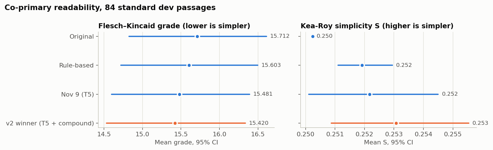
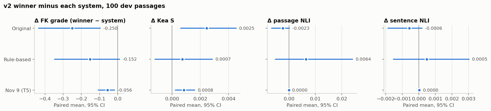
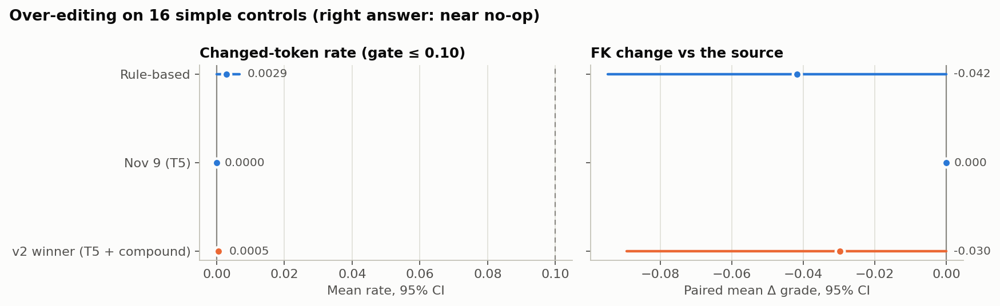
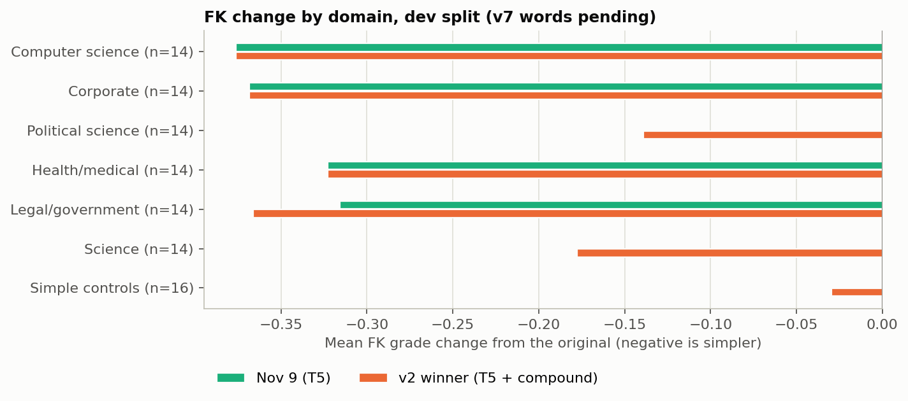
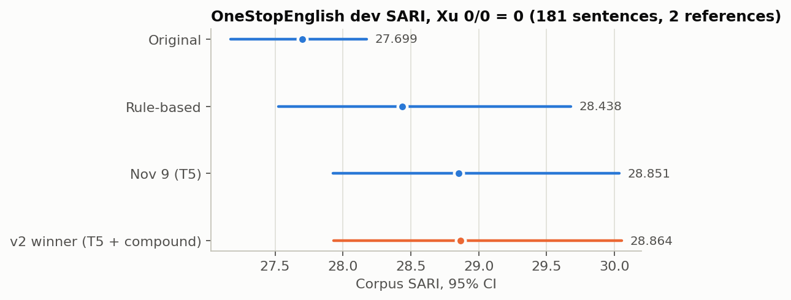

# Test set v3: dev split, November 16, 2026

The November 10 winner, `words=off, phrases=authored,
structure=t5+compound_tagger`, was chosen on the same 90 week 7 passages
that produced its headline numbers. This report scores it on new text it
has never seen: the **dev split** of test set v3, 100 passages from six
domains plus already-simple controls, and 181 OneStopEnglish sentences. The
200-passage **test split stays locked** for one final run, which Joshua
triggers later. Metrics, gates and the final-run rule were
[pre-registered](PROTOCOL.md) before any score. No LLM is used anywhere.
Raw text stays local; this folder holds aggregates only.

**v7 words is not in this report yet.** At Joshua's request the cheap systems
ran first. v7 words takes 3–9 minutes per passage on this panel's longer
passages, and when the other four finished it was at 70 of 100 dev passages,
with OneStopEnglish still to run. Its run continues, and its numbers will be
added when it is complete. This report was generated with `--omit v7_words`
and names it as omitted.

## Result

**On unseen text the winner still simplifies and keeps meaning, but by less
than half the week 7 effect.** It passes every pre-registered gate and does
not over-edit simple text.

| 100 dev passages (84 standard + 16 controls) | Original | Rule-based | Nov 9 winner (T5) | **v2 winner (T5 + compound)** |
|---|---:|---:|---:|---:|
| Flesch–Kincaid grade ↓ | 14.627 | 14.529 | 14.433 | **14.377** |
| Kea-Roy simplicity S ↑ | 0.2502 | 0.2519 | 0.2518 | **0.2527** |
| Passage NLI mean | 0.9861 | 0.9773 | 0.9837 | 0.9838 |
| Passages with passage NLI < 0.80 | 0 | 1 | 1 | 1 |
| Sentence-level NLI mean | 0.9888 | 0.9878 | 0.9882 | 0.9882 |
| Entities preserved (fixed check) | 1.000 | 1.000 | 1.000 | 1.000 |
| Number / negation failures | 0 / 0 | 0 / 0 | 0 / 0 | 0 / 0 |
| Changed passages | 0 | 30 | 8 | 14 |
| Gates 1–4 | ref | ref | pass | **pass** |

Paired against the original, the winner moves FK by **−0.250
[−0.435, −0.095]** over all 100 passages and by **−0.292 [−0.514, −0.109]**
over the 84 standard ones. Kea S moves by **+0.0028 [+0.0006, +0.0053]** on
the standard passages. Both are 95% CIs from a bootstrap stratified by domain
(10,000 resamples, seed 20261116). On the week 7 panel it was selected on, the
same config moved FK by −0.609. On the 14 passages it changes, FK falls from
15.64 to 13.86 and passage NLI is 0.969 (lowest 0.777).

Applied to dev, the final-run rule would give *confirmed*:

- **R:** the ΔFK CI is below 0 and the ΔS CI is above 0 on the standard passages.
- **M:** gates 1–4 pass.
- **O:** the over-edit gate passes.

This is a dev result. It is descriptive, and nothing was tuned on it.



Against the other systems (paired, all 100 passages):

| Winner minus | ΔFK | ΔKea S | Δ passage NLI | Δ sentence NLI |
|---|---:|---:|---:|---:|
| Original | −0.250 [−0.435, −0.095] | +0.0025 [+0.0006, +0.0045] | −0.0023 [−0.0066, +0.0001] | −0.0006 [−0.0019, +0.0002] |
| Rule-based | −0.152 [−0.347, +0.011] | +0.0007 [−0.0012, +0.0029] | +0.0064 [−0.0052, +0.0241] | +0.0005 [−0.0015, +0.0030] |
| Nov 9 winner | **−0.056 [−0.107, −0.016]** | +0.0008 [+0.0002, +0.0016] | +0.0000 [−0.0000, +0.0001] | +0.0000 [+0.0000, +0.0001] |



- **The compound splitter adds a real but small gain on new text.** It is
  simpler than the Nov 9 winner by 0.056 grade, with a CI that excludes 0,
  and its NLI is identical. That is half of its week 7 effect (−0.112, CI
  touching 0).
- **It is not clearly simpler than the rule-based dictionary** (the CI crosses
  0). Rule-based touches 30 passages; one corporate passage falls to NLI
  0.21.
- **Kea S barely moves for any system.** It is relative to the source, and
  the winner makes no word substitutions. Only the S_read part, mostly
  sentence length, can change, and only on the 14 edited passages. The
  scale is passage-level, which is outside the sentence-level data it was
  fitted on (PROTOCOL).

## Over-editing: simple controls

On the 16 Simple English Wikipedia controls, where the right answer is close
to a no-op, the winner changes one passage. Its changed-token rate is 0.0005
and its FK change is −0.030 [−0.089, 0]. The Nov 9 winner changes none and
rule-based changes three. Every system passes the over-edit gate (rate ≤ 0.10,
no control with NLI < 0.80).



## By domain

The FK gain is in the dense genres: computer science, corporate, health and
legal, each about −0.3 to −0.4 grade. It is smaller in political speeches
and science abstracts, where T5 alone changes nothing on dev and the compound
splitter alone does the work. Each domain has only 14 passages, so these are
point estimates; per-domain tables are in
[aggregate-results.json](aggregate-results.json).



## OneStopEnglish (second multi-reference SARI set)

OneStopEnglish (Vajjala & Lučić 2018) is licensed CC BY-SA 4.0, checked
against the repository licence. We use its 544 advanced sentences that align
to both an intermediate and an elementary version, which gives two references
each. 181 are dev; 363 test sentences are locked.

| 181 dev sentences | SARI, Xu 0/0 = 0 [95% CI] | SARI, `evaluate` 0/0 = 1 | FK | Changed |
|---|---:|---:|---:|---:|
| Original | 27.70 [27.17, 28.17] | 62.97 | 11.97 | 0 |
| Rule-based | 28.44 [27.52, 29.68] | 62.78 | 11.95 | 5 |
| Nov 9 winner | 28.85 [27.93, 30.03] | 59.74 | 11.30 | 32 |
| **v2 winner** | **28.86 [27.93, 30.05]** | 59.57 | 11.26 | 33 |

The references average FK 11.06 (intermediate) and 10.57 (elementary). Both
T5 systems beat copying under the Xu convention, and their CIs clear the
original's. Under `evaluate`'s 0/0 = 1 convention, copying wins, as it does on
ASSET. Alignments come from cosine similarity, and the split is by sentence,
so dev and test can share an article (PROTOCOL).



ASSET test was already used on November 9 and is not rescored; see the
[v2 report](../20261110-ensemble-v2/README.md).

## Metric changes in this round

- **Entity check fixed** (PR #18). Sentence-initial words that are
  capitalized only by position ("However", "Patients") are no longer counted
  as entities, and multi-word names stay whole. Under the old check, rule-based
  scored 0.975 on dev, because it was penalised for dropping such words; under
  the fixed check every system scores 1.000. The old value is in
  `entities_capitalized`. Gate 4 is not discriminating on this panel.
- **Kea-Roy's human-calibrated S** is co-primary with FK. It uses the trained
  word weights and the fitted G/H/I sentence weights, the configuration that
  `evals/README.md` recommends.
- **Over-edit metrics** apply to the simple controls.

## Panel

[`evals/data/testset_v3/`](../../data/testset_v3/README.md) has 300 passages
of 60–120 words, selected by
[`build_testset_v3.py`](../../build_testset_v3.py):

- **Computer science:** IETF RFCs.
- **Corporate:** SEC 10-Ks.
- **Political science:** presidential inaugurals and State of the Union addresses.
- **Health:** openFDA prescription labels.
- **Legal:** Federal Register significant rules.
- **Science:** CC BY 4.0 arXiv physics and q-bio abstracts.
- **Simple controls:** Simple English Wikipedia good articles.

Each pool is defined by a rule (an index filter, an API query or a category);
the code then samples it with a fixed seed and takes non-overlapping
consecutive-sentence windows. No document from the week 7 panel is reused.
The split is by document, stratified by domain, and was committed (`7d3afcc`)
before scoring. Licences are recorded per passage. Rule-based filters remove
markup, cross-references and run-in headings; a few drug-label run-in
subheadings survive in health passages.

## Reproduction and provenance

[provenance.json](provenance.json) records:

- the commits;
- the plan hash, signatures and runtime;
- the batch receipts and every queue job with its outcome.

The run used Yoga CPU, one thread per process, `PYTHONHASHSEED=0` and offline
models, on the personal queue at `later` priority. Batches were bounded and
checkpointed per passage, with one cleartext job at a time.

- Two jobs failed at the start, because the worktree lacked the ignored
  `models/data` cache. They were fixed and resubmitted after a one-passage
  smoke test.
- Several batches were stopped by the queue's memory valve under host
  pressure. The checkpoints kept completed cells.
- The dev plan was frozen at `422109b`, before PR #18's entity fix. This
  report was generated from `main` after PR #18, against that state. Entity
  numbers are recomputed from the texts with the fixed check. The other
  cached metrics do not depend on it (PROTOCOL, Amendment 1).
  `report_sources_sha256` in [aggregate-results.json](aggregate-results.json)
  pins the report-time code.

```bash
python -m evals.testset_v3 report --state ~/.local/state/cleartext/testset-v3-20261116/run1 \
    --omit v7_words --out evals/reports/20261116-testset-v3
python evals/reports/20261116-testset-v3/make_figures.py   # matplotlib, separate venv
```

Readability, Kea S, NLI, entity and SARI scores are automatic signals, not
percentages of correct simplifications.
